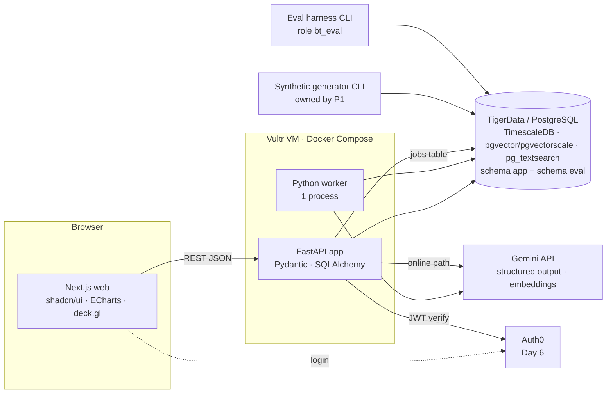
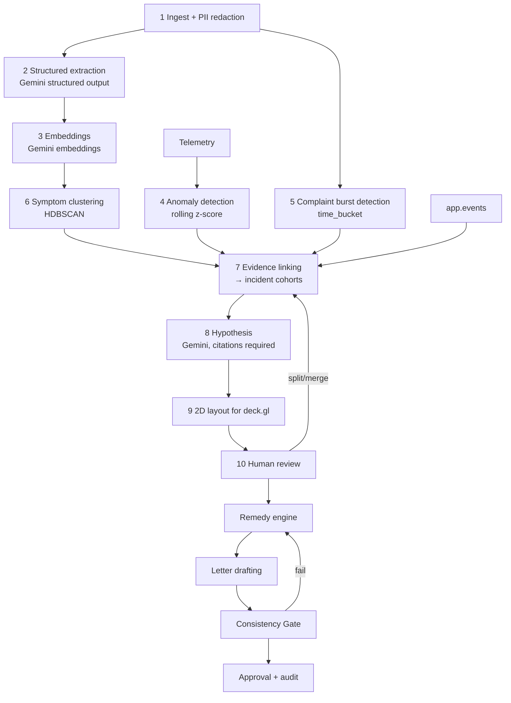

# Backtrace — Technical Design Doc

Sep 27, 2026 · @Bruce · v2 — finalized stack

> **Status:** this document is the source of truth for implementation. When code and document disagree, fix one of them immediately; do not let them drift. Every new architectural decision must be recorded here and in the Change Log.

## Demo Thesis

Every feature in Backtrace must support at least one of the three statements below. Throughout this document, features are tagged **[T1]**, **[T2]**, **[T3]**. A feature that cannot be tagged is not built.

1. **[T1] Complaint labels are not root causes.** The label a customer gives a complaint ("wrong bill", "slow internet", "TV lost signal") is not its root cause. Many different descriptions can come from one incident, and customers often blame the wrong thing.
2. **[T2] Operational evidence can reveal shared causes that text alone misses.** Telemetry, time, region, topology, and operational event history connect complaints that text alone would keep apart.
3. **[T3] One verified cause can drive one consistent, human-approved resolution across a cohort.** Once a human confirms the cause, one deterministic remedy formula applies to the whole cohort, and every customer letter passes a consistency check.

**Hero narrative:** *"Thousands of complaints. Dozens of descriptions. One underlying failure."*

## 1. Overview

Backtrace is a **root-cause engine for customer complaints**. It groups thousands of complaints into a few cohorts by root cause, links each cohort to the infrastructure or operational event that caused it, and lets a human approve one consistent remedy for the whole group.

**Original brief:** the client wants AI to automatically triage and respond to complaints to clear the backlog and raise their regulator score above 4.0 within 12 months. The challenge slide says explicitly that the answer is not necessarily what the client asked for.

**Core insight:** a backlog of 10,000 complaints is not 10,000 problems. It is a slow, noisy sensor for a handful of operational failures, and customers often blame the wrong thing. Resolve by cause, not by ticket.

**How this differs from the usual approaches:**

| Usual approach | What it does | What Backtrace does differently |
| --- | --- | --- |
| Complaint classifier | Labels by the topic the customer mentions | Groups by true cause using time, region, topology, telemetry; detects when customers blame the wrong thing [T1][T2] |
| Sentiment dashboard | Describes how angry people are | Reduces the number of decisions humans must make and points to the fault to fix [T3] |
| Chatbot | Deflects or delays complaints | Resolves complaints instead of obstructing them |
| AI auto-response | Generates N independent replies that may be inconsistent | One evidence-backed decision per cohort; money computed by rules, the LLM only writes the letter [T3] |

**Backtrace is NOT:** a generic chatbot, a generic analytics dashboard, a multi-agent system, a regulator-score predictor, or a full CRM.

**Design principles:** human-in-the-loop on every monetary decision; every hypothesis cites evidence; every metric is measurable against ground truth; the demo must run with no network. Detailed architectural principles are in §6.1.

## 2. Core demo flow

The architecture is optimized for exactly this 10-step script. Anything that does not serve it is lower priority.

| # | Demo step | Responsible component | Thesis | Precomputed or live |
| --- | --- | --- | --- | --- |
| 1 | Show thousands of unresolved complaints | deck.gl scatter, `complaint_layout` | T1 | Precomputed |
| 2 | Points visually collapse into a small number of cohorts | deck.gl animation driven by `cohort_members` | T1 | Precomputed |
| 3 | Open one cohort whose complaints describe apparently different issues | Cohort view: `claimed_cause` distribution, sample complaints | T1 | Precomputed |
| 4 | Operational evidence links them to one underlying incident | Evidence view: ECharts timeline (complaint burst × telemetry anomaly), topology scope, cited hypothesis | T2 | Precomputed |
| 5 | Reviewer confirms the root cause | `POST /cohorts/{id}/confirm`, audit log | T3 | Live |
| 6 | Deterministic remedy engine computes consistent remedies | Remedy engine + `remedy_policies` | T3 | Live (no LLM call) |
| 7 | Gemini writes personalized letters | Letter drafting | T3 | Cached for the demo cohort |
| 8 | Consistency Gate verifies them | Gate (rules first, then LLM) | T3 | LLM part cached |
| 9 | Human approves the cohort-level action | `approvals`, RBAC (dev auth or Auth0) | T3 | Live |
| 10 | A new complaint arrives and attaches to the open incident/cohort | Online path (§8.4) | T1, T2 | Live (backup text + cache) |

**Definition of "demo done":** all 10 steps run end to end on the `demo` dataset, both online and in offline mode (§14).

## 3. Assumptions & constraints

The whole prototype runs on synthetic data with ground truth; there are no claims about regulator score.

**Hard constraints (from the challenge):**

- No real dataset, no regulator-score formula, no regulator documentation. Only a single brief image.
- No claims like "regulator score improves by X%". Only report metrics measured on synthetic data.
- Every use of synthetic data or an assumption must be clearly labeled in the UI, README, and pitch.
- No benchmark, accuracy, performance, or business-impact numbers are filled in ahead of time. Every number in the pitch must come from the eval harness (§13).

**Team & time constraints:** 4 people, 1-week hackathon. Timeline in §19.

**Working assumptions (to be confirmed):**

- **The client is a telecom/ISP.** Inferred from the sponsor being Ciena (optical networking equipment, whose customers are carriers) and the slide listing "a piece of infrastructure" as a valid answer. Not confirmed.
- **If the assumption is wrong:** the architecture still works. The `events` table is generic (network alarm, billing run, deploy, policy change), so the cohort ↔ event linking layer works with any operational event source.
- **Handling time per human decision** is an assumption, used only in the capacity panel and always shown as an editable assumption.

**What the system can and cannot demonstrate:**

| Can demonstrate (on synthetic data) | Cannot demonstrate |
| --- | --- |
| Recovers the planted root causes | Performance on real complaint data |
| Reduces the number of human decisions needed | Impact on regulator score |
| Remedies consistent with policy | Customer satisfaction |
| Gate catches defects planted in drafts | Real-world ombudsman overturn rate |

## 4. Prototype scope

Feature freeze at end of Day 5; anything beyond must-have is built only once the must-haves run end to end.

**Must-have** — no demo without these:

- **Synthetic world + ground-truth dataset** in three sizes (`tiny`, `dev`, `demo`), with the answer key in a separate schema the pipeline cannot read. [T1][T2][T3]
- **Structured extraction**: Gemini structured output extracts JSON against a fixed Pydantic schema from each complaint. [T1]
- **Symptom clustering**: HDBSCAN groups complaints by what customers *say*, keeping one-off complaints as noise instead of forcing them into groups. [T1]
- **Telemetry anomaly detection + cohort ↔ event linking**: links complaints to events via time, region/node, topology, telemetry, and event scope. This is where cause-based cohorts are formed. [T2]
- **Cohort review UI + evidence view**: confirm, split, merge cohorts; show evidence. [T1][T2][T3]
- **Deterministic remedy engine**: compensation computed by rules from the synthetic policy document. [T3]
- **Consistency Gate** checks letters before approval. [T3]
- **Cohort-level approval** (dev auth first, Auth0 later). [T3]
- **Live ingestion**: a new complaint automatically attaches to an open cohort (demo step 10). [T1][T2]
- **Eval harness**: one command runs all metrics, baselines, and ablations. [T1][T2][T3]

**Should-have** — what makes the demo win:

- **Auth0 RBAC** for the approval flow — only after the end-to-end path works (Day 6). [T3]
- **Hybrid retrieval** (vector + BM25 + RRF) for search and candidate retrieval (§9). Supporting infrastructure, not the root-cause algorithm. [T1][T2]
- **Ablation** text-only vs text + structure vs text + structure + telemetry, run early (Day 3). [T2]
- **Capacity panel**: human decisions before/after, with assumptions shown clearly. [T3]

**Stretch** (details in §17):

- Auth0 step-up MFA for above-threshold remedies.
- Voice ingestion via ElevenLabs Speech-to-Text.
- Cloudflare Durable Objects / Agents for live incident state (optional extension, not on the critical path).
- Proactive notification when telemetry detects an incident before complaints flood in (impact is a simulated assumption).
- Run eval over multiple generator seeds to report variance.

**Do not build, even with spare time:** customer-facing chatbot, multi-agent architecture, model fine-tuning, a custom or separate vector DB, Kafka/Redis/RQ/any message broker, more than one worker, microservices, blockchain audit log, regulator-score predictor, full CRM, real email sending, voice agent calling customers, mobile app, multi-tenancy, generic analytics dashboard.

## 5. Synthetic dataset & ground truth

Build a world first, then let complaints emerge from it; never generate complaints directly with labels attached.

### 5.1 Three dataset sizes

The generator takes a size profile + seed + event config file. Developers do **not** need the `demo` dataset for daily iteration.

| Profile | Customers | Complaints | Root-cause events | Used for |
| --- | --- | --- | --- | --- |
| `tiny` | \~100 | \~100 | \~3 | Unit/integration tests, CI, debugging. Must load in seconds; fixture can be committed. |
| `dev` | \~5,000 | \~1,000–2,000 | \~6–8 | Daily development, early ablation on Day 3. |
| `demo` | up to \~50,000 | \~8,000–10,000 | \~12–15 | Demo snapshot and final evaluation only. Generated at freeze. |

- **Eval split:** the *held-out* set is generated at `demo` size with a **different seed and event config** from anything used during development. Only held-out numbers are reported. The demo snapshot may use its own world; neither is used for tuning.
- All profiles keep comparable proportions of noise, misattribution, and overlapping events, so behavior on `dev` reflects `demo`.
- All generator output is labeled `synthetic` in the DB (`pipeline_runs.dataset_profile`, `dataset_seed`) and in the UI.

### 5.2 World parameters (apply to every profile, scaled by size)

| Component | Value |
| --- | --- |
| Regions | 6–10 (fewer for `tiny`) |
| Time window | 90 days (`tiny`/`dev` may be shorter) |
| One-off complaints (noise) | 15–25% |
| Telemetry step | 1–5 minutes per link/node |

### 5.3 World model

- **Fictional carrier** (no real names), topology of sites, rings, links, and a customer → serving node mapping.
- **Products**: residential fiber internet, business ethernet, TV, bundles; each plan has a daily price for computing compensation.
- **Customers**: id, region, node, plan, tenure, residential/business, vulnerability flag.
- **Remedy policy document** (synthetic): credit rules by hours of outage, refunds for overcharges, priority handling for vulnerable customers, list of forbidden commitments in letters.

### 5.4 Root causes (ground-truth events)

- **Network incidents**: fiber cut (total loss of connectivity), optical signal degradation (intermittent packet loss), maintenance overrunning its notice window, DNS failure.
- **Non-network causes**: billing run error (double charge), price increase not properly notified, technician no-show, wrongly applied cancellation fee, agent script error. These are mandatory so the system is not designed around a single answer.
- Each event has: `start_at`, `end_at`, the set of affected customers (computed via topology), severity, complaint probability.
- **Separation:** the generator writes *ground truth* to the `eval` schema. Separately, it writes *observable operational traces* (alarms, billing run logs, deploy records — possibly missing, late, or noisy) to `app.events`. The pipeline sees only traces, never the truth. Some root causes deliberately have no event record at all.

### 5.5 Telemetry

- Time series per link/node: optical power, errored seconds, packet loss, latency, alarms.
- Network incidents are planted as corresponding anomalies.
- **Decoys**: anomalies with no customer impact (redundant path), and incidents with weak telemetry signal.

### 5.6 Complaint schema

| Field | Description | Visible to pipeline? |
| --- | --- | --- |
| `complaint_id`, `customer_id` | Identifiers | Yes |
| `received_at`, `channel` | Timestamp, channel (phone/email/chat/web) | Yes |
| `text` | LLM-generated text from a structured seed + persona | Yes |
| `product`, `region`, `node_id` | From the customer profile | Yes |
| `is_repeat`, `prior_complaint_ids` | Repeat complaints | Yes |
| `escalation_status`, `escalated_at`, `sla_deadline` | Escalation state | Yes |
| `root_cause_id`, `secondary_cause_id` | True cause | No (answer key) |
| `customer_claimed_cause` vs `true_cause` | Measures misattribution detection | No |
| `financial_impact`, `customer_impact_severity` | Outage hours × daily price, overcharged amount | No |
| `vulnerability_flag`, `vulnerability_mentioned` | Whether vulnerable, whether the text mentions it | No |
| `gold_remedy` | Policy-correct remedy, computed deterministically | No |
| `injected_defect` | Defect planted in a draft to test the Gate | No |

### 5.7 Noise and hard cases

- Misattribution: some customers lose connectivity but write about their bill. [T1]
- One incident affecting multiple products (internet + TV + bundle) → many different descriptions of the same cause. [T1]
- Multi-issue complaints, repeat complaints, vague text, typos, strong emotion.
- Two events overlapping in time in the same region — the most likely false-merge case. [T2]
- One-off complaints belonging to no event.
- Text containing exact terms (plan names, incident IDs, fee names) to exercise lexical search. [supports T1]

### 5.8 Preventing circularity

- **Data wall**: one person (P1, §19) owns the generator and the answer key; the people building the pipeline do not see the held-out seed or event config.
- The held-out event config is **not committed to the repo** until after freeze.
- The answer key lives in the `eval` schema with its own DB role; the `bt_pipeline` role cannot read it.
- The `backtrace` package (pipeline + API) must not import the `backtrace_eval` package; a CI test enforces this import rule.
- Different prompts, temperatures, and if possible models for data generation versus extraction.
- The pitch says plainly: synthetic data proves the system recovers known structure, not that it performs on real data.

## 6. System architecture

One monorepo, one FastAPI application, one PostgreSQL/TigerData database, at most one Python worker. Gemini is used only for language; no microservices, no message broker.

### 6.1 Architectural principles

1. **LLMs handle language, not deterministic business decisions.**
2. **Monetary remedies are always calculated by deterministic rules.**
3. **Gemini may:** extract structured complaint information; generate embeddings; summarize evidence; write root-cause hypotheses grounded in evidence; draft customer communication.
4. **Gemini must NOT** independently determine compensation amounts. Gemini output is never an input to a monetary formula.
5. **Ground-truth evaluation data is inaccessible to the application pipeline** (DB role + import rule).
6. One monorepo.
7. One FastAPI application.
8. One PostgreSQL/TigerData database.
9. At most one Python worker for background processing.
10. No unnecessary microservices or message brokers.
11. Prefer simple, debuggable implementations.
12. Every important hypothesis is traceable to concrete evidence (complaint ids, event/anomaly ids, score components).
13. All synthetic-data assumptions are explicitly labeled.
14. No claims of regulator-score improvement.

### 6.2 Overall diagram



- **Web** talks only to the API. No direct DB access.
- **API** handles requests, review/approve actions, and the online path for new complaints.
- **Worker** runs the batch pipeline and long jobs (extraction, embedding, clustering, linking, drafting). Jobs are queued in a Postgres table (§11).
- **Generator** and **eval harness** are CLIs in the same monorepo, not services.
- Cloudflare and ElevenLabs are optional extensions and are not on the critical-path diagram (§17).

### 6.3 Tech stack

| Layer | Choice | Rationale | Thesis |
| --- | --- | --- | --- |
| Frontend | Next.js + React + TypeScript + Tailwind CSS + shadcn/ui | Fast to build review UI; ready-made table/dialog/form components | T1–T3 |
| Charts | ECharts | Complaint × telemetry timeline, `claimed_cause` distribution; one charting library | T1, T2 |
| Large viz | deck.gl (ScatterplotLayer, transitions) | Render and animate 10k points in WebGL; SVG stutters at this size | T1 |
| API | Python 3.12+, FastAPI, Pydantic | All ML/data work is in Python, avoiding two runtimes; Pydantic is the shared data contract | — |
| ORM / migrations | SQLAlchemy 2.x + Alembic | Versioned schema, reproducible migrations | — |
| Worker | One Python process, job queue in a Postgres table (`SELECT … FOR UPDATE SKIP LOCKED`) | No Redis/RQ/Kafka needed | — |
| Database | TigerData / PostgreSQL + TimescaleDB | Hypertables and `time_bucket` for telemetry and burst detection | T2 |
| Vector search | pgvector (+ pgvectorscale if an index is needed) | Embeddings live in the same DB as operational data | T1 |
| Lexical search | pg_textsearch (BM25); fallback to Postgres built-in `tsvector` | Preserves exact terms that embeddings blur | supports T1 |
| LLM | Gemini API: structured output + embedding model | Schema-bound extraction, embeddings, cited hypotheses, letter drafting | T1, T3 |
| ML | HDBSCAN (`sklearn.cluster.HDBSCAN`), scikit-learn, NumPy, Pandas | Determines cluster count itself and keeps noise; anomaly detection via simple statistics | T1, T2 |
| Auth | Auth0 (RBAC, approval flow) — Day 6, after the core path works | Accountability for every decision | T3 |
| Infra | Docker + Docker Compose on Vultr | One machine, few moving parts | — |
| Optional | Cloudflare Durable Objects / Agents; ElevenLabs STT | Extensions only; the system runs fully without them | — |

**Gemini model IDs** (text and embedding) are pinned in config and recorded in `llm_calls.model`; never hard-coded.

### 6.4 Monorepo layout

```
backtrace/
├── apps/
│   └── web/                     # Next.js (App Router), shadcn/ui, ECharts, deck.gl
│       └── src/lib/api-types.ts # generated from FastAPI OpenAPI (openapi-typescript)
├── backend/
│   ├── pyproject.toml
│   ├── alembic/                 # migrations
│   └── src/
│       ├── backtrace/           # application package — MUST NOT import backtrace_eval
│       │   ├── api/             # FastAPI routers
│       │   ├── contracts/       # Pydantic models: extraction schema, API DTOs, evidence
│       │   ├── db/              # SQLAlchemy models, session, roles
│       │   ├── pipeline/        # redact, extract, embed, anomalies, cluster, link, hypothesis, layout
│       │   ├── retrieval/       # vector, lexical, RRF
│       │   ├── remedy/          # deterministic engine + policies
│       │   ├── gate/            # consistency gate
│       │   ├── llm/             # Gemini client, cache, prompt registry
│       │   ├── jobs/            # job table, worker loop
│       │   └── auth/            # dev auth + Auth0 JWT verification
│       └── backtrace_eval/      # generator + eval harness (owned by P1)
│           ├── generator/
│           └── harness/
├── configs/
│   ├── pipeline.yaml            # thresholds, linking weights, model IDs, prompt versions
│   └── worlds/                  # tiny/dev world configs (held-out NOT committed before freeze)
├── fixtures/tiny/               # generated tiny dataset, committed for tests
├── infra/
│   ├── docker-compose.yml
│   └── docker-compose.offline.yml
└── Makefile                     # make up, make migrate, make seed-tiny, make pipeline, make eval
```

### 6.5 API surface (minimum)

| Method | Path | Purpose | Demo step |
| --- | --- | --- | --- |
| GET | `/health` | API + DB health, worker heartbeat | — |
| GET | `/runs/latest` | Current run, dataset profile, synthetic label | 1 |
| GET | `/viz/complaints` | Points for deck.gl: `id, x, y, cohort_id, symptom_cluster_id, claimed_cause` | 1–2 |
| GET | `/cohorts` · `/cohorts/{id}` | Cohort list and detail | 2–3 |
| GET | `/cohorts/{id}/evidence` | Timeline, anomalies, topology scope, linking score components, hypothesis | 4 |
| POST | `/cohorts/{id}/confirm` · `/split` · `/merge` | Human review | 5 |
| POST | `/cohorts/{id}/remedy` | Run the remedy engine | 6 |
| POST | `/remedies/{id}/drafts` | Enqueue letter drafting job | 7 |
| POST | `/remedies/{id}/gate` | Run the Consistency Gate | 8 |
| POST | `/remedies/{id}/approve` | Cohort-level approval | 9 |
| POST | `/complaints` | Ingest a new complaint (online path) | 10 |
| GET | `/complaints/{id}` | Detail + assignment + reasons | 10 |
| GET | `/search?q=` | Hybrid search over complaints/evidence | 3–4 |
| GET | `/jobs/{id}` | Job status | — |

Every request/response is a Pydantic model in `backtrace/contracts/`; the frontend uses types generated from OpenAPI.

## 7. Data model

Two schemas: `app` for everything the pipeline and UI use, `eval` for the answer key, with a separate DB role the pipeline cannot use. All tables are created through Alembic migrations.

### 7.1 Schema `app`

| Table | Kind | Main contents |
| --- | --- | --- |
| `customers` | Regular table | id, region, node\_id, plan, tenure, segment (residential/business) |
| `network_nodes`, `network_links` | Regular table | Topology: site, ring, link, parent node |
| `events` | Regular table | Observable operational traces: `source` (network\_alarm / billing\_run / deploy / policy\_change), `start_at`, `end_at`, scope (node/region/plan/customer list), payload JSON, `search_text` |
| `telemetry` | Hypertable | `ts`, `link_id`, optical\_power, errored\_seconds, packet\_loss, latency\_ms |
| `telemetry_5m` | Continuous aggregate | Telemetry rollup for the UI timeline and anomaly detection |
| `complaints` | Regular table | The pipeline-visible fields from §5.6; index on `received_at` |
| `complaint_features` | Regular table | Extracted JSON (Pydantic `ComplaintExtraction`), `extraction_version`, `pii_redacted_text` |
| `complaint_embeddings` | pgvector | `complaint_id`, `embedding vector(n)`, `model_version` |
| `complaint_search` | BM25 index (pg_textsearch) or `tsvector` column | Lexical index over `pii_redacted_text` + extracted fields |
| `complaint_layout` | Regular table | `run_id`, `complaint_id`, `x`, `y` (2D position for deck.gl) |
| `detected_anomalies` | Regular table | Telemetry anomalies found by the pipeline: link, start/end, score, method |
| `symptom_clusters` | Regular table | HDBSCAN clusters by what customers say: id, `run_id`, short label, size |
| `cohorts` | Regular table | id, status (proposed/confirmed/split/merged/resolved), hypothesis, hypothesis\_citations JSON, confidence, `run_id` |
| `cohort_members` | Regular table | cohort\_id, complaint\_id, membership\_score, `assigned_by` (batch/online/human) |
| `cohort_event_links` | Regular table | cohort\_id, event\_id or anomaly\_id, overlap\_score, time\_offset, evidence JSON (each score component) |
| `remedy_policies` | Regular table | Versioned rules: condition → credit/refund formula |
| `remedies` | Regular table | cohort\_id or complaint\_id, amount, policy\_rule\_id, policy\_version, rationale |
| `letters` | Regular table | remedy\_id, complaint\_id, draft, prompt\_version, gate\_result JSON |
| `approvals` | Regular table | remedy\_id, approver user\_id, role, auth\_mode (dev/auth0), mfa\_used, decided\_at, decision |
| `audit_log` | Append-only | Every action: actor, action, target, before/after, `prev_hash`, `hash` |
| `jobs` | Regular table | id, type, payload JSON, status, attempts, locked\_at, error, `run_id` |
| `llm_cache` | Regular table | `key` = hash(model, prompt\_version, input), response JSON |
| `llm_calls` | Hypertable | stage, prompt\_version, model, tokens\_in/out, latency\_ms, cost, cache\_hit |
| `pipeline_runs` | Regular table | run\_id, config JSON, dataset\_profile, dataset\_seed, started/finished, stage timings |
| `eval_summaries` | Regular table | run\_id, metric, value, split — **aggregate numbers only**, no per-complaint labels |

**Why `complaints` and `events` are regular tables:** at a maximum of \~10k complaints and a few dozen events, hypertables add no benefit and complicate foreign keys. `time_bucket` still works on regular tables for burst detection. `telemetry` and `llm_calls` are where the genuinely large time-series data lives.

**Vector index:** at `demo` size, exact search on pgvector is sufficient; add an index (pgvector HNSW or pgvectorscale StreamingDiskANN) only if measured to be slow.

### 7.2 Schema `eval`

| Table | Contents |
| --- | --- |
| `gold_events` | Planted root causes: type, time, affected customer set |
| `gold_complaint_labels` | root\_cause\_id, secondary\_cause\_id, claimed vs true cause, financial\_impact, vulnerability |
| `gold_remedies` | Policy-correct remedy per complaint |
| `gold_draft_defects` | Drafts with planted defects and the defect type |
| `eval_results` | run\_id, metric, value, split (dev/held-out), seed, missed-case details |

**Access rules:**

- Role `bt_pipeline` (API + worker) has privileges on `app` only.
- Role `bt_eval` reads both, and is used only by the generator and eval harness CLIs, never by the API or worker.
- The eval harness writes aggregate numbers to `app.eval_summaries` for the eval page. Missed-case details live only in `eval.eval_results` and the generated report file, never in `app`.
- No pipeline code path reads `eval_summaries` to make decisions.

**Audit log:** each row stores the hash of the previous row (hash chain) to detect tampering. This is a sufficient replacement for the "blockchain audit log" idea.

## 8. Processing pipeline

The language branch and the operational branch run in parallel and meet at the linking step; cause-based cohorts are formed from operational evidence, not from text alone. No monetary decision is made before human review.

### 8.1 Batch pipeline diagram



### 8.2 Steps in detail

1. **Ingest + PII redaction** [T3]: mask names, phone numbers, and addresses with regexes + the name list from customer profiles before any text is sent to an LLM.
2. **Structured extraction** [T1]: Gemini structured output with a response schema generated from the Pydantic model `ComplaintExtraction`: `product`, `symptoms[]`, `claimed_cause`, `issue_start_mentioned`, `amounts[]`, `issues[]` (each distinct issue), `vulnerability_signals[]`, `requested_outcome`, `identifiers[]` (incident IDs, plan names, fee names quoted verbatim). Validate with Pydantic; on validation failure → retry once → mark `needs_review`. Store `extraction_version`.
3. **Embeddings** [T1]: embed the redacted text + symptom summary with the Gemini embedding model, store in pgvector.
4. **Anomaly detection** [T2]: rolling z-score (or simple change-point) per link with Pandas/NumPy, reading from `telemetry_5m`. No deep learning models. Results go to `detected_anomalies`.
5. **Complaint burst detection** [T2]: complaint counts per region/node per 15 minutes (`time_bucket`) compared to a rolling baseline.
6. **Symptom clustering** [T1]: HDBSCAN on embeddings (PCA dimensionality reduction if needed, parameters in config) combined with normalized structured fields. The result is **symptom clusters** — groups by what customers *say*. Complaints in no cluster are kept as noise. A symptom cluster is **not** a cohort.
7. **Evidence linking → incident cohorts** [T2]: see §8.3. This is where different symptom clusters (e.g. "no internet", "wrong bill", "TV frozen") are joined into the same incident.
8. **Hypothesis** [T2][T3]: Gemini receives an *evidence pack* (linking score components, sample complaints, anomalies, events) and writes a root-cause hypothesis that must cite `complaint_id`s and `event_id`/`anomaly_id`s from the pack. A validator checks that every cited id exists in the pack; a hypothesis without valid citations is not shown. The hypothesis never affects membership or money.
9. **Layout** [T1]: compute 2D positions for deck.gl — t-SNE/PCA (scikit-learn) over cohort centroids, then place points around their centroid with jitter; also store "before collapse" positions (by symptom cluster/random) to animate demo steps 1→2.
10. **Human review** [T3]: confirm, split, merge cohorts; flag members needing individual handling. Split/merge re-runs linking for the affected cohorts.
11. **Remedy → Gate → Approval → audit** [T3]: see §10 and §12.

### 8.3 Evidence linking (the core root-cause algorithm)

Root-cause linking relies **primarily on explicit evidence**. Hybrid retrieval (§9) plays no part in scoring here.

**Candidates:** all `app.events` and `detected_anomalies` within the run's time window.

**Score for each (complaint, candidate) pair**, with each component stored separately:

| Component | Meaning | Source |
| --- | --- | --- |
| `scope_match` | Customer is within the event's scope: via topology (node under the affected link) for network incidents; via customer/plan list for billing runs or policy changes | `customers`, `network_*`, `events.scope` |
| `region_node_overlap` | Coarse region/node overlap when detailed topology is unavailable | `customers`, `events` |
| `temporal` | `received_at` falls within `[start_at, end_at + lag_max]`, decaying with lag | `complaints`, `events`/`detected_anomalies` |
| `telemetry` | The link serving the customer has a pipeline-detected anomaly overlapping in time | `detected_anomalies` |
| `burst` | Candidate coincides with a complaint burst in that region/node | Step 5 |
| `semantic` | Similarity of the complaint to members already attached to the candidate | Embeddings |

- **Total score** = weighted sum; weights and thresholds live in `configs/pipeline.yaml` and are never learned from gold labels. `semantic` is weighted lower than the operational components — that is thesis T2.
- **Assignment:** a complaint goes to the highest-scoring candidate above threshold; two candidates with close scores → `needs_review`, no automatic choice.
- **Cohort** = the set of complaints assigned to the same candidate (or to a group of candidates with overlapping scope, e.g. an alarm + anomaly on the same link). `cohort_event_links.evidence` stores the fraction of members satisfying each component for the evidence view.
- **No operational evidence:** complaints that cannot be attached to any candidate stay grouped by symptom cluster, and the cohort is labeled *"no linked operational evidence"*. Noise complaints remain noise.
- **Overlapping events:** two candidates at the same time in the same region are separated by topology-based `scope_match`; this is the false-merge case measured separately (§13).

### 8.4 Online path (new complaint) — demo step 10

1. `POST /complaints` → redact → extraction → embedding (same code as batch, called directly in the request for low demo latency; results cached).
2. **Candidate retrieval** [supports T1]: fetch the top-K open cohorts. The first version uses vector search; once hybrid retrieval exists, use vector + BM25 + RRF (§9), then vote by the cohorts of the nearest complaints.
3. **Evidence check** [T2]: for each candidate cohort, recompute the §8.3 score components against its linked event (scope, temporal, telemetry). Retrieval only proposes candidates; the assignment decision rests on evidence.
4. High confidence → attach to the cohort (`assigned_by = online`); the agent sees the approved remedy and a personalized letter (still passing the Gate). Low confidence or `vulnerability_signals` present → individual review queue.
5. The UI shows the assignment reason: which cohort, which event, which score components.

### 8.5 Reproducibility and caching

- Every run has a `run_id` and stored config; the same seed + config must produce the same result (fixed seeds for HDBSCAN/PCA/t-SNE).
- Gemini responses are cached in `llm_cache` keyed by hash of (model, prompt\_version, input); re-running the pipeline costs no extra tokens.
- Gemini calls are batched with bounded concurrency to avoid rate limits; daily development uses the `dev` profile to keep cost and time low.
- Prompts are versioned in a prompt registry; changing a prompt = bumping its version = an intentional cache miss.

## 9. Retrieval & search

Hybrid retrieval is **supporting infrastructure**, not the root-cause algorithm. It helps find candidates and helps humans look things up; it does not decide membership or cause.

### 9.1 Where it is used

| Where | Purpose | Thesis |
| --- | --- | --- |
| Online path (§8.4 step 2) | Fetch candidate cohorts for a new complaint | T1 |
| Review UI search | Reviewer searches "double charge", plan names, incident IDs within a cohort or across the backlog | T1 |
| Hypothesis evidence pack | Pick representative complaints with diverse descriptions for the same cohort | T1, T2 |
| Event lookup | Match incident IDs/terms in complaints against `events.search_text` | T2 |

### 9.2 Design

- **Vector:** cosine similarity over `complaint_embeddings` (pgvector) — finds semantically similar complaints even with different wording.
- **Lexical:** BM25 via pg_textsearch over `pii_redacted_text` + `identifiers[]` — preserves exact terms: product names, incident IDs, technical terms, fee names, account terminology.
- **Fusion:** Reciprocal Rank Fusion: `score(d) = Σ 1 / (k + rank_i(d))` over the two lists; `k` and top-K in config. No learned re-ranker.
- **Hard filters** applied before ranking when context exists: time window, region, cohort status.
- **Fallback:** if pg_textsearch is unavailable on an instance (managed or local image), use Postgres built-in `tsvector` + `ts_rank` behind the same `retrieval.lexical_search()` interface. Checking extension availability is a Day 1 task.
- **Build order:** vector-only first (Day 2–5); BM25 + RRF once the core path works (Day 6 if not done earlier). The online path must work with vector-only.

## 10. Remedy engine & Consistency Gate

Rules decide the money, the LLM only writes the words, and the Gate blocks any draft whose amount, content, or handling does not match policy. [T3]

### 10.1 Remedy engine (deterministic)

- **Input:** confirmed cohort (or single complaint), linked event, customer profile, `remedy_policies` table.
- **Output:** remedy type, amount, applied `policy_rule_id` + `policy_version`, and a human-readable rationale.
- **Example rules (synthetic):** outage ≥ threshold hours → credit proportional to daily price; overcharge → exact refund + fixed goodwill amount; vulnerable customer → always routed to individual review, never an automatic cohort remedy.
- Rules are versioned; every remedy stores the version used so it can be re-checked.
- A cohort gets **one formula**, but the amount is computed per member (e.g. outage hours differ by node).
- The engine is pure Python, no network calls, no LLM calls; unit-tested on the `tiny` dataset.

### 10.2 Letter drafting

- Gemini drafts letters from a template with pre-filled slots: amount, confirmed cause, that customer's extracted issues.
- The LLM may not change the amount or add commitments; the Gate re-checks both.
- Drafting runs as a worker job; letters for the demo cohort are precomputed and cached.

### 10.3 Consistency Gate

| Check | Method | Type |
| --- | --- | --- |
| Amount in letter matches remedy | Exact match against the amount extracted from the letter | Rule |
| No forbidden commitments | Forbidden phrase/commitment list from the policy document | Rule + LLM |
| Every issue addressed | LLM checks each item in `issues[]` is addressed | LLM |
| Vulnerability signals | Non-empty `vulnerability_signals[]` → block cohort remedy, route to individual handling | Rule |
| Consistent with cohort | Member remedy is within the allowed range of the cohort formula | Rule |

- **Result:** `pass`, `fail` with a specific reason, or `needs_review`. Every result is stored in `letters.gate_result`.
- Rules run before the LLM; a draft that fails a rule spends no LLM tokens.
- Gate fail → the draft returns to drafting (at most one automatic retry), then `needs_review`.

## 11. Worker & job handling

One Python worker, one `jobs` table, no broker.

- **Enqueue:** the API or a CLI inserts a row into `app.jobs` (`type`, `payload`, `run_id`).
- **Dequeue:** the worker loops `SELECT … FROM app.jobs WHERE status='queued' ORDER BY id FOR UPDATE SKIP LOCKED LIMIT 1`, marks it `running`, runs it, then `done`/`failed` with `error`.
- **Job types:** `pipeline.run` (full batch for a run), `pipeline.stage` (re-run one stage), `letters.draft`. Eval does **not** run in the worker, because the worker uses the `bt_pipeline` role.
- **Idempotent:** each stage writes results keyed by `run_id` and can be safely re-run; thanks to `llm_cache`, re-runs cost no tokens.
- **Retry:** up to N attempts (config) with simple backoff; Gemini rate-limit errors are retried, schema validation errors are not.
- **Heartbeat:** the worker updates a heartbeat periodically; `/health` reports a dead worker.
- **No** scheduler, no multi-process parallel jobs. If a stage needs parallelism (batched Gemini calls), use bounded in-process concurrency (asyncio/thread pool).

## 12. Authentication, authorization & audit

Every decision has a named owner. Auth0 is integrated **only after the end-to-end path works**; before that, dev auth with the same interface. [T3]

| Role | Can | Cannot |
| --- | --- | --- |
| `agent` | View cohorts, handle one-off complaints, send approved remedies for new complaints | Approve cohort remedies |
| `team_lead` | Confirm/split/merge cohorts, approve remedies below threshold | Approve remedies above threshold |
| `compliance` | Approve remedies above threshold, edit `remedy_policies` | — |

- **Threshold:** a remedy affecting more than N customers or totaling more than $X requires the `compliance` role. N and X are configuration, not validated numbers.
- **Dev auth (Day 1–5, and offline mode):** `AUTH_MODE=dev`; three fixed demo users, selected via header/cookie. The same FastAPI dependency `current_user()` returns `user_id` + `role`.
- **Auth0 (Day 6):** frontend logs in via Auth0 → receives a JWT with a role claim (custom namespace) → FastAPI verifies the JWT via JWKS and checks the role on every write endpoint. Only the implementation of `current_user()` changes; endpoints stay the same.
- **Step-up MFA (stretch):** when `compliance` approves an above-threshold remedy, the API requires a token with a recent MFA claim; if missing, it returns an error so the frontend triggers MFA.
- **Audit:** every action records `user_id`, role, `auth_mode`, action, target, before/after state, and the hash chain (§7).
- **Demo:** three pre-created demo accounts, one per role; no personal accounts.

## 13. Evaluation plan

Every number in the pitch comes from the eval harness run on the held-out set, compared against three baselines; no number is filled in before it is measured.

### 13.1 Baselines

1. **Keyword/category classifier**: labels by the topic the customer mentions.
2. **Text-only clustering**: HDBSCAN on text embeddings, without structured fields or telemetry.
3. **Per-complaint LLM auto-response**: exactly what the brief asked for; Gemini reads each complaint and proposes a remedy + letter. This is the only place an LLM proposes money, and it exists purely for comparison.

### 13.2 Metrics

| Group | Metric | Notes | Thesis |
| --- | --- | --- | --- |
| Clustering | ARI, NMI, homogeneity, completeness | Prioritize homogeneity: a false merge causes harm, an over-split only costs one extra review | T1 |
| Clustering | False-merge rate | % of cohorts containing > 1 significant root cause; the most important metric | T1, T2 |
| Root-cause recovery | Cause-level recall | Number of causes with at least one cohort reaching a configured precision threshold | T1 |
| Event linking | Top-1 accuracy, start-time error, region precision/recall | Only for causes with a corresponding event | T2 |
| Misattribution | % of complaints with `claimed_cause ≠ true_cause` assigned to the correct true cause | Direct evidence against a classifier | T1 |
| Assignment | Membership precision/recall; % of noise correctly kept as noise | Per complaint | T1 |
| Online assignment | Precision/recall of assigning new complaints (held-out, replayed in time order) | Measure vector-only vs hybrid retrieval separately if available | T1, T2 |
| Consistency | Exact match with `gold_remedy`, amount MAE, remedy variance across customers in the same situation | Compared to baseline 3; report honestly even if the baseline does well | T3 |
| Quality gate | Precision/recall per planted defect type; false alarm rate | On `gold_draft_defects` | T3 |
| Workload | Human decisions = cohorts to review + complaints handled individually | Compared to N complaints; no conversion to hours unless labeled as an assumption | T3 |
| Latency/cost | Time and tokens per 1,000 complaints; online end-to-end latency | From `llm_calls` | — |

### 13.3 Ablation [T2]

- **A:** text-only. **B:** text + structured fields. **C:** text + structure + telemetry/topology/event linking.
- **Run early on `dev` on Day 3.** If C is not clearly better than B, thesis T2 is weak and the narrative shifts its emphasis to T1 (misattribution detection). Record this decision in this document.
- Re-run on held-out on Day 5 after freeze; only held-out numbers go into the pitch.

### 13.4 Process

- Develop on `tiny`/`dev`; the held-out set (`demo` size, different seed, different event config) runs only at freeze.
- One command: `make eval RUN=<run_id> SPLIT=heldout` runs baselines + ablation + metrics, writing `eval.eval_results`, `app.eval_summaries`, and a Markdown report.
- Every run stores `run_id`, config, seed.
- The eval page in the app shows the latest aggregate numbers from `eval_summaries`; the missed-case list lives in the report, not in the app schema.
- Stretch: run over 3–5 generator seeds, report mean ± standard deviation.

## 14. Observability & demo reliability

The demo must run fully with no network; minimal observability lives in Postgres, with no extra services.

**Observability:**

- Structured (JSON) logs with `run_id`, `request_id`, `job_id` on every line.
- Per-stage timings in `pipeline_runs`; LLM cost and latency in `llm_calls`.
- A small admin page: tokens, cost, cache hit rate, slowest stage of the latest run, job status.
- Health endpoint for the API and worker heartbeat.

**Demo reliability:**

- **Demo snapshot:** all pipeline results for the `demo` dataset are precomputed and preloaded into the DB (a `pg_dump` restorable with one command).
- **LLM cache:** every response used in the demo script is cached; the live path only calls the LLM for new complaints, and the backup complaints are cached too.
- **Offline mode:** `docker-compose.offline.yml` runs web + API + worker + local Postgres/TimescaleDB with `LLM_MODE=cache_only`, `AUTH_MODE=dev`. No dependency on Gemini, Auth0, Vultr, or Cloudflare.
- **Backup live complaints:** prepared text (and audio files if voice is built) so the demo does not depend on live typing or speaking.
- **Backup video** of the full demo, ready to play if everything else fails.
- **Test on the actual projector:** the 10k-point animation must be smooth at the venue's resolution; have a plan to reduce the number of rendered points.

## 15. Deployment

- **Local dev:** `make up` → Docker Compose: `web`, `api`, `worker`, `db` (TimescaleDB image with pgvector/pgvectorscale; pg_textsearch if the image supports it, otherwise the `tsvector` fallback).
- **Deploy:** one Vultr VM running Docker Compose (`web`, `api`, `worker`, TLS reverse proxy). The database is managed TigerData; Compose does not run `db` in this environment.
- **Migrations:** `alembic upgrade head` runs as the owner role at deploy; the API/worker use the `bt_pipeline` role.
- **Secrets:** environment variables via an uncommitted `.env` (Gemini key, DB URL, Auth0 config).
- **Day 1 check:** confirm TimescaleDB, pgvector, pgvectorscale, and pg_textsearch are available on both the managed instance and the local image; record the result in the README. Differences between the two environments are handled by fallbacks, not by separate code paths.
- **Domain:** optional; the Vultr URL is enough for the demo.

## 16. Sponsor integrations

Keep TigerData, Gemini, and Auth0 because they are a natural part of the product; Vultr is infrastructure; ElevenLabs and Cloudflare are optional; drop Solana and Presage.

| Sponsor | Decision | Role in the system | Appears in the demo | Thesis |
| --- | --- | --- | --- | --- |
| TigerData | Keep — most natural fit | Hypertable + continuous aggregate for telemetry, `time_bucket` for bursts, pgvector/pgvectorscale for embeddings, pg_textsearch for BM25 | Complaint timeline aligned with telemetry in step 4; hybrid search | T2 |
| Gemini API | Keep | Structured extraction, embeddings, cited hypotheses, letter drafting | Evidence panel, letter drafts | T1, T3 |
| Auth0 | Keep, Day 6 | Three-role RBAC, threshold-based approval, `user_id` in audit; step-up MFA is stretch | Large remedy blocked until `compliance` approves | T3 |
| Vultr | Keep, hosting only | Runs Docker Compose | Not part of the narrative | — |
| ElevenLabs | Stretch, conditional | Speech-to-Text feeding phone complaints into the same `POST /complaints` | Live voice complaint attaching to a cohort | T1 |
| Cloudflare | Optional extension | Durable Objects / Agents holding live incident state (§17) | Only if everything else is done | — |
| GoDaddy | Downgraded to optional | Domain if needed | URL on the final slide | — |
| Solana | Drop | — | — | — |
| Presage | Drop | — | — | — |

- **ElevenLabs:** STT for ingestion only. No voice agent calling customers. If test audio is generated with ElevenLabs' own TTS, label it clearly as synthetic audio.
- **Solana:** a blockchain audit log is a forced integration; a Postgres hash chain does what is needed, and customer complaint data should not sit on a public chain.
- **Presage:** no reasonable use case in the finalized stack.

## 17. Stretch features & optional extensions

Nothing here is on the critical path. Each item sits behind a feature flag that defaults to off; the demo and eval run fully with all of them off.

### 17.1 Cloudflare Durable Objects / Agents (optional)

- **Possible role:** one Durable Object per open incident, holding live state (new complaint count, latest assignment, workflow step awaiting approval); receiving live complaints and forwarding them to `POST /complaints`; resuming long-running workflows (awaiting approval → drafting → gate) after interruption.
- **Constraint:** FastAPI + Postgres remain the source of truth; the Durable Object only holds a copy of state and calls the API. No linking, remedy, or gate logic lives in Cloudflare. Turning Cloudflare off removes no demo capability.
- **When:** only after Day 6, once all must-haves and should-haves are done.

### 17.2 ElevenLabs Speech-to-Text (optional)

- Audio → STT → text → the same online path. No voice-specific logic.
- Backup audio files are prepared in advance; transcripts are cached too.

### 17.3 Other stretch items

- Auth0 step-up MFA for above-threshold remedies.
- Proactive notification: telemetry anomaly with an early complaint burst → suggest opening a cohort before complaints flood in (impact is a simulated assumption, clearly labeled).
- Multi-seed eval.

## 18. Risk register

The biggest risk is that telemetry does not improve results over text-only; the Day 3 ablation must reveal this.

| Type | Risk | Mitigation |
| --- | --- | --- |
| Technical | Telemetry linking does not improve on text + structure | Day 3 ablation on `dev`; if weak, shift narrative emphasis to T1 (misattribution detection) |
| Technical | Linking falsely merges two time-overlapping events | Topology-based `scope_match`; measure false merges; UI allows splitting cohorts |
| Technical | Gemini rate limits or latency on `demo`-size batches | Daily work on `dev`; batched calls with bounded concurrency; hash-keyed cache; precompute |
| Technical | Extraction unstable across runs | Pydantic-derived response schema, low temperature, prompt versioning, cache, prompt freeze on Day 7 |
| Technical | pg_textsearch or pgvectorscale missing in one environment | Day 1 check; `tsvector` and exact pgvector search fallbacks behind the same interface |
| Technical | 10k-point animation stutters | deck.gl WebGL; test on the real projector; reduce rendered points |
| Technical | Hybrid retrieval eats time without changing demo results | It is a should-have; online path works with vector-only; build it late |
| Scope | Early Auth0 or Cloudflare integration slows the core path | Auth0 only on Day 6 after dev auth; Cloudflare optional, after Day 6 |
| Team | 4 people touching the same schema/contracts causes conflicts | Pydantic contracts + migrations settled on Day 1; schema changes reviewed by one person |
| Data | Circularity: writing both the questions and the answers | Data wall, separate `eval` schema role, import rule, uncommitted held-out with a different seed, public acknowledgment |
| Data | LLM-generated text too clean and uniform | Diverse personas, typos, misattribution, multi-issue complaints, one-off complaints |
| Data | Customer → node mapping cleaner than reality | Add noise to the mapping; state it as an integration requirement with the carrier's inventory data |
| Business logic | Cohort remedy unfair to edge cases | Vulnerable customers and low-confidence cases are always handled individually |
| Business logic | Telecom-client assumption is wrong | Generic `events` table; dataset includes non-network causes |
| Privacy | Sending complaint text to an external LLM | PII redaction before every call; data residency is a question for real deployment |
| Demo | Network loss or external service failure during the demo | Offline mode, demo snapshot, cache, backup video |

## 19. Implementation timeline (1 week, 4 people)

**Suggested roles** (people can swap; responsibility boundaries stay fixed):

- **P1 — Data & Eval:** generator, answer key, data wall, eval harness, ablation. The only person who sees the held-out config.
- **P2 — Pipeline/ML:** extraction, embeddings, anomalies, clustering, linking, hypothesis, online path, retrieval.
- **P3 — Frontend:** Next.js, shadcn/ui, deck.gl, ECharts, cohort review, evidence view.
- **P4 — Backend/Platform:** FastAPI, DB/migrations, jobs/worker, remedy engine, gate, auth, deploy.

| Day | Goal | Main work | Done when |
| --- | --- | --- | --- |
| **Day 1** | Running skeleton | Monorepo; Docker Compose; DB + extensions; Alembic migrations for `app`/`eval` schemas + roles; FastAPI + Next.js skeleton; Pydantic contracts (extraction, API DTOs, evidence); `tiny` dataset | `make up && make migrate && make seed-tiny` works; web lists `tiny` complaints via the API; extension check recorded in README |
| **Day 2** | Real data + language | Full generator (`dev` profile); Gemini structured extraction + cache; embeddings; jobs table + worker; basic deck.gl scatter | Pipeline extracts + embeds all of `dev`; re-runs spend no tokens; scatter shows `dev` points |
| **Day 3** | Root cause | HDBSCAN symptom clusters; anomaly detection; burst detection; evidence linking → cohorts; ablation A/B/C on `dev` | Cohorts + links in DB for `dev`; first ablation report; T2-vs-T1 narrative decision recorded |
| **Day 4** | Review → resolution | Cohort review UI; evidence view (ECharts timeline); deterministic remedy engine; Gemini letter drafting; Consistency Gate; approval with dev auth | Demo steps 1–9 work on `dev` through the UI |
| **Day 5** | Live + measurement | Online ingestion + cohort assignment (vector-only is fine); one-command eval harness; generate held-out + `demo`; held-out metrics; **feature freeze at end of day** | Demo step 10 works; `make eval` produces held-out numbers; no new features after today |
| **Day 6** | Controlled finishing | Auth0 (RBAC + approval); sponsor integrations; hybrid retrieval if not done; Vultr deploy; UI polish | 10-step demo works on the deployed build with Auth0; offline mode still works with dev auth |
| **Day 7** | Stabilize | No major new features; testing; prompt freeze; cache warming; benchmark runs; demo snapshot; offline/failure fallback check; record backup video; pitch rehearsal | Demo runs fully offline from the snapshot; every pitch number traces to `eval_results` |

**Timeline rules:**

- Every day ends with `main` able to `make up` and run the demo up to the step reached so far.
- A feature that misses its day's done-criterion gets its scope cut; it does not spill into the next day and push everything back.
- Cloudflare and ElevenLabs start only once Day 6's criterion is met.

## 20. Open questions

The first question must be answered before writing code; the rest are settled on Day 1–2.

- [ ] Is the assumed client a telecom/ISP? (Ask the Ciena mentor.)
- [ ] Do the organizers have public judging criteria or a rubric?
- [ ] What are N customers and $X for `compliance` approval in the demo?
- [ ] Which Gemini model for extraction/drafting, and which (different) model for data generation?
- [ ] Are pg_textsearch and pgvectorscale available on the provided TigerData instance?
- [ ] Build voice ingestion (ElevenLabs) or keep it as stretch?
- [ ] Final product name and domain (check trademarks before buying, if buying).

## Change Log

### Kept from original design

- **Product thesis and problem framing:** the backlog is a noisy sensor for a few incidents; resolve by cause, not by ticket. This is the core, now written explicitly as Demo Thesis T1–T3.
- **Synthetic-data philosophy:** build the world first, then generate complaints; answer key in a role-separated `eval` schema; data wall; held-out with a different seed; public acknowledgment of limits. Kept because this is what makes the numbers credible.
- **Evaluation strategy:** three baselines, the metric set (prioritizing false merges and homogeneity), A/B/C ablation, no numbers before measurement.
- **Human-in-the-loop and deterministic remedies:** rules decide money, the LLM only writes letters, rules-before-LLM Consistency Gate, vulnerable customers always handled individually.
- **Three RBAC roles, configurable approval threshold, hash-chained audit log.**
- **Demo reliability:** snapshot, LLM cache, offline mode, backup complaints, backup video.
- **The do-not-build list**, and the decision to drop Solana/Presage.

### Changed

- **Added Demo Thesis and Core demo flow (Demo Thesis section, §2), with a thesis tag on every feature.** Why: the document must be the implementation source of truth; thesis tags give the team a clear criterion for cutting scope.
- **Cohorts are formed from operational evidence, not coarse clustering by `product`.** The original first grouped coarsely by `product` + `region` + time, then ran HDBSCAN. That splits differently worded complaints about the same incident — directly contradicting T1 and demo step 3. Now HDBSCAN produces only *symptom clusters* (what customers say), and *evidence linking* (§8.3) with explicit score components forms cause-based cohorts.
- **Evidence linking specified in detail** (score components, weights in config, each component stored). Why: principle 12 — every hypothesis traceable to evidence.
- **Added Retrieval & search section (§9):** vector + BM25 (pg_textsearch) + RRF, with a `tsvector` fallback. Positioned explicitly as supporting infrastructure that takes no part in root-cause scoring. The online path uses retrieval for candidates, but assignment is decided by evidence.
- **Finalized stack:** added shadcn/ui, Pydantic, SQLAlchemy, Alembic, Python 3.12+; visualization reduced to deck.gl + ECharts (PixiJS dropped); HDBSCAN via `sklearn.cluster.HDBSCAN`. Why: one toolset, no unresolved "or" choices.
- **Worker:** a single Python worker with a `jobs` table + `SKIP LOCKED`; RQ option dropped. Why: RQ needs Redis, violating the one-database, no-broker principle.
- **`complaints` and `events` changed from hypertables to regular tables; added `telemetry_5m` continuous aggregate.** Why: at a maximum of \~10k complaints, hypertables add nothing and complicate foreign keys; telemetry is the genuinely large time-series data. Burst detection uses `time_bucket` on a regular table.
- **New tables:** `symptom_clusters`, `complaint_layout`, `complaint_search`, `letters` (split from `remedies`), `jobs`, `llm_cache`, `eval_summaries`. Why: reflects the new pipeline, job handling, and showing eval results without letting the pipeline read the answer key.
- **Eval page reads aggregate numbers only** from `app.eval_summaries`; missed-case details live in the report. Why: the original had the app show missed cases, which would put gold labels in a schema the pipeline can read, violating principle 5.
- **Added the import rule** (`backtrace` must not import `backtrace_eval`) and uncommitted held-out config until freeze. Why: in a monorepo, the data wall must be enforced by tooling, not just convention.
- **Three dataset sizes `tiny`/`dev`/`demo`** replace a single target scale; `demo` scale adjusted to \~8,000–10,000 complaints and \~12–15 root causes (original: 8,000–12,000 and 12–20). Why: faster, cheaper development loop; nobody runs the full dataset daily.
- **Auth0 moved to Day 6, after dev auth with the same interface; step-up MFA made stretch.** Why: Auth0 must not block the end-to-end path; offline mode needs dev auth anyway.
- **Ablation moved earlier: Day 3** (original: no later than Day 4). Why: the sooner the T2-vs-T1 narrative decision, the less wasted work.
- **Timeline rewritten for 1 week, 4 people**, with roles and a done-criterion per day; feature freeze stays at end of Day 5.
- **Diagram placeholders replaced with Mermaid**, plus monorepo layout and API surface so Codex can implement directly.
- **Added Deployment section (§15)** with a Day 1 extension check and the rule that environment differences are handled by fallbacks.
- **Risk register:** added risks for extension availability, retrieval time sink, early Auth0/Cloudflare integration, 4-person coordination, and network loss during the demo.
- **Document language switched from Vietnamese to English** so it can serve directly as the Codex source of truth.

### Deferred / removed

- **Cloudflare Durable Objects / Agents — added as an optional extension.** Off the critical path; Postgres remains the source of truth. Why: useful for the "live incident" story, but the system must run fully without it.
- **ElevenLabs STT — remains stretch**, sharing the online path.
- **Auth0 step-up MFA — moved to stretch.** RBAC + approval is enough for T3.
- **Hybrid retrieval — should-have, not must-have.** The online path must work with vector-only.
- **Multi-seed eval — kept as stretch.** The original listed it both as stretch and in the eval process; now consistently stretch.
- **RQ/Redis — removed.** Violates the one-database, no-broker principle.
- **PixiJS — removed.** deck.gl is enough for 10k points; one large-viz library.
- **GoDaddy — downgraded to optional.** Not in the finalized stack; the Vultr URL is enough for the demo.
- **Presage open question — removed**, since Presage is out of the stack.
