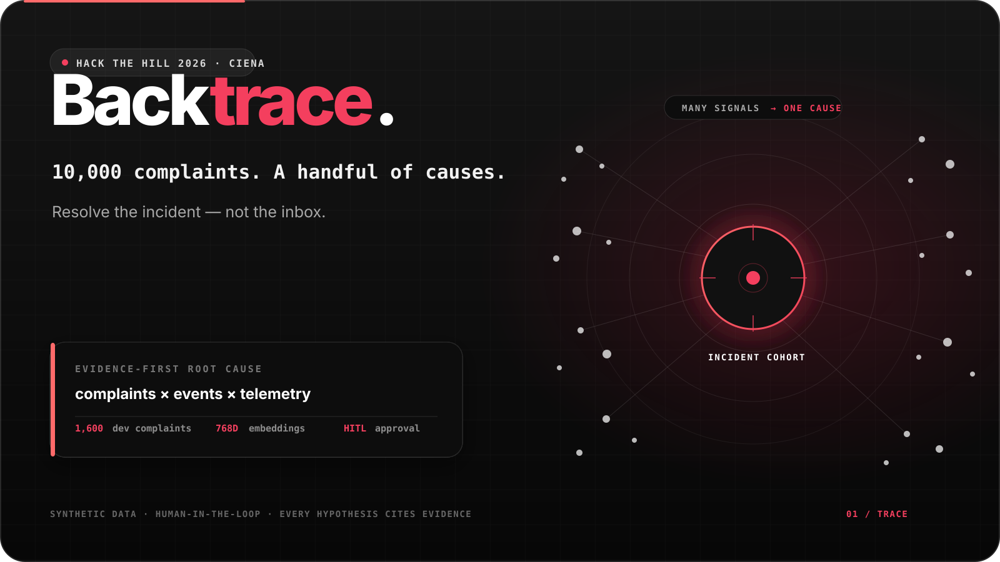
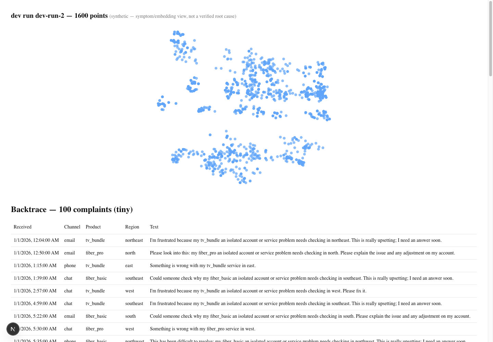
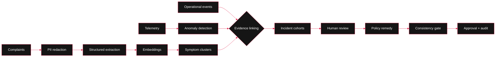

<div align="center">



# Backtrace

### 10,000 complaints. A handful of causes.

**An evidence-first root-cause engine for telecom complaint backlogs.**<br>
Built for the **Ciena track at Hack the Hill 2026** in Ottawa.

[](#why-backtrace)
[](#trust-boundaries)
[](#built-with)
[](#built-with)
[](#built-with)

_Resolve the incident — not the inbox._

</div>

---

## Why Backtrace

The challenge asks how AI could help clear a large complaint backlog. The obvious answer is to classify and reply to every ticket faster.

Backtrace starts one level deeper:

> A backlog of 10,000 complaints is not 10,000 independent problems. It is a slow, noisy sensor for a handful of operational failures.

A customer may report “wrong bill,” “slow internet,” or “TV lost signal,” while all three complaints originate from the same network incident. Backtrace combines complaint language with operational events, topology, bursts, and telemetry anomalies to recover that shared cause. A reviewer can then approve one consistent resolution for the entire incident cohort.

This is deliberately **not** a chatbot, a sentiment dashboard, or an autonomous claims processor. Backtrace reduces the number of decisions humans must make while keeping evidence and approval visible.

## See it running

The screenshot below is captured from the local application against the real `dev-run-2` database state: **1,600 synthetic complaints** projected from their **768-dimensional embeddings**. It is the current engineering view, not a fabricated final-product mockup.



> [!NOTE]
> The current scatter is a symptom/embedding view. It does **not** claim that visible groups are verified root causes. Incident cohorts are formed only after operational evidence linking.

## The demo story

1. **See the backlog** — thousands of unresolved complaints appear as individual points.
2. **Find the signal** — Gemini extracts structured symptoms and creates embeddings from PII-redacted text.
3. **Watch operations** — rolling statistics detect telemetry anomalies and complaint bursts.
4. **Link by evidence** — time, region, topology, event scope, and telemetry connect different symptoms to the same incident.
5. **Review the cause** — every hypothesis cites the complaints and operational evidence behind it.
6. **Resolve consistently** — deterministic policy rules compute remedies; Gemini personalizes letters.
7. **Keep a human in charge** — a consistency gate runs before cohort-level approval and audit.



## Why it is different

| Typical complaint AI | Backtrace |
| --- | --- |
| Classifies each ticket by its wording | Separates what customers **say** from what **caused** it |
| Generates one answer per complaint | Resolves a cause-based cohort consistently |
| Optimizes sentiment or response speed | Reduces the number of human decisions |
| Presents an uncited model conclusion | Requires complaint and operational evidence |
| Lets the LLM influence compensation | Keeps money in deterministic policy rules |

## Built with

| Layer | Technology | Responsibility |
| --- | --- | --- |
| Web | Next.js 16, React 19, TypeScript, Tailwind, shadcn/ui | Review workflow and complaint visualization |
| Large visualization | deck.gl | WebGL rendering for thousands of complaint points |
| API and contracts | FastAPI, Pydantic | Typed boundaries for complaints, jobs, runs, and evidence |
| Data and time series | PostgreSQL 16, TimescaleDB, SQLAlchemy, Alembic | Source of truth, telemetry, jobs, migrations, and audit data |
| Semantic layer | pgvector, Gemini structured output and embeddings | Complaint features and semantic similarity |
| Root-cause pipeline | NumPy, scikit-learn | PCA, anomaly detection, clustering, and evidence scoring |
| Runtime | Docker Compose, one Postgres-backed worker | Reproducible local stack without an extra queue or broker |

## Architecture choices that matter

### Evidence outranks semantics

Semantic similarity helps, but it is intentionally the weakest linking signal. Operational evidence — scope, topology, time, telemetry, and complaint bursts — owns the root-cause decision.

### The answer key is physically separated

Synthetic ground truth lives in the `eval` schema. The application role can read only `app`, and a test forbids the production `backtrace` package from importing `backtrace_eval`. The pipeline cannot grade itself or tune against hidden labels.

### Language models never decide money

Gemini performs schema-bound extraction, embeddings, cited hypothesis writing, and letter drafting. Remedy amounts come from versioned deterministic rules; a human approves the action.

### The demo survives without the network

LLM responses are hash-cached, pipeline stages are idempotent per run, and the final demo path is designed to operate from a precomputed snapshot.

## Current build status

Backtrace is under active hackathon development. This table describes the repository today, not the final pitch deck.

| Capability | Status |
| --- | --- |
| Dockerized web, API, worker, and TimescaleDB stack | ✅ Working |
| Synthetic `tiny` and `dev` worlds with isolated ground truth | ✅ Working |
| PII redaction, Gemini structured extraction, persistent cache | ✅ Working |
| Batched Gemini embeddings and deck.gl projection | ✅ Working |
| Dev auth, pagination bounds, typed API contracts | ✅ Working |
| Root-cause tables and configurable evidence weights | ✅ Working |
| Rolling z-score telemetry anomaly stage | 🧪 Implemented on the current branch |
| Complaint burst detection, HDBSCAN, evidence linking | 🚧 Next pipeline stages |
| Cohort review, remedy, gate, approval, live ingestion | 🗺️ Demo roadmap |

The implementation source of truth is [Backtrace — Technical Design Doc.md](Backtrace%20%E2%80%94%20Technical%20Design%20Doc.md). It documents the full ten-step demo, scoring model, trust boundaries, and explicit scope cuts.

## Run locally

### Prerequisites

- Docker Desktop with Docker Compose
- Python 3.12 or newer
- `make`

### Start the stack

```bash
python3 -m venv backend/.venv
backend/.venv/bin/pip install -e "./backend[dev]"
cp .env.example .env

make up
make migrate
make seed-tiny
```

Then open:

- Web app: [http://localhost:3000](http://localhost:3000)
- API docs: [http://localhost:8000/docs](http://localhost:8000/docs)
- Health check: [http://localhost:8000/health](http://localhost:8000/health)

No Gemini key is required to browse the seeded `tiny` dataset. Real extraction or embedding runs require `GEMINI_API_KEY` in `.env`; cached and fake-provider tests remain network-independent.

### Useful commands

```bash
make test-backend       # backend test suite
make check-extensions   # TimescaleDB / pgvector capability check
make generate-dev       # generate the synthetic dev world
make enqueue-run        # enqueue the default dev pipeline run
make job-status RUN_ID=<run-id>
make down
```

## Trust boundaries

- **Synthetic data only.** The repository does not claim performance on real customer complaints.
- **No regulator-score claims.** Any final metric must come from the held-out evaluation harness.
- **PII is redacted before external model calls.** Names, phone numbers, and addresses are masked first.
- **Every hypothesis cites evidence.** Unsupported IDs are rejected instead of displayed.
- **Low-confidence and vulnerable cases stay individual.** Cohort automation never removes human review.
- **No hidden gold-label access.** Production code and database roles are separated from evaluation truth.

## Repository map

```text
hacktheHill/
├── apps/web/               # Next.js dashboard + deck.gl
├── backend/
│   ├── src/backtrace/      # production API, worker, pipeline, data contracts
│   ├── src/backtrace_eval/ # synthetic generator + evaluation-only code
│   ├── alembic/            # versioned Postgres migrations
│   └── tests/              # unit, contract, DB, and pipeline tests
├── configs/                # pinned models, thresholds, worlds, policies
├── fixtures/tiny/          # committed offline fixture
├── infra/                  # Docker Compose stack
└── Backtrace — Technical Design Doc.md
```

---

<div align="center">

**Built in Ottawa for Hack the Hill 2026.**<br>
_Find the cause. Show the evidence. Resolve once._

</div>
